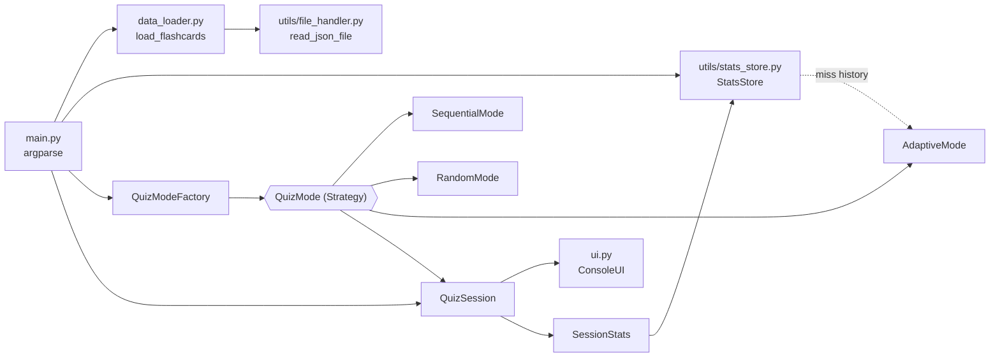

# Flashcard Quizzer

A command-line flashcard app that loads decks from JSON and quizzes you in
**sequential**, **random** or **adaptive** order. Adaptive mode brings back the cards
you miss, both later in the same session and first in your next session.

Built by Mohammad Afsharnejad for the Udacity *AI-Assisted Software Engineering*
course, directing Claude Code and reviewing every step (see
[docs/ai_edit_log.md](docs/ai_edit_log.md) and [docs/report.md](docs/report.md)).

```
Flashcard Quizzer - glossary.json
Mode: sequential | Cards: 10 | Limit: 3
Type your answer and press Enter. Type "exit" to stop.

Question 1: API
Your answer: application programming interface
Correct!

Question 2: CDN
Your answer: content delivery
Incorrect — answer: Content Delivery Network

Question 3: CPU
Your answer: central processing unit
Correct!

Quiz Summary
Total Questions  3
Correct          2
Accuracy         66.7%
Missed terms     CDN
```

## Features

- **Three quiz modes:** `sequential` (deck order), `random` (shuffled; `--seed` makes
  the order repeatable) and `adaptive`.
- **Adaptive re-queue and history:**
  - A missed card comes back two questions later, up to 3 extra times, so the quiz
    always ends.
  - Cards you missed most in earlier sessions are asked first.
- **Forgiving answers:** case, extra spaces and surrounding whitespace are ignored.
- **Clear feedback:** green "Correct!", red "Incorrect — answer: X", and a summary
  table with Total Questions, Correct, Accuracy % and Missed terms. `--no-color`
  (or the `NO_COLOR` environment variable) gives plain output.
- **Lifetime stats:** `--stats` shows sessions, questions, accuracy and most-missed
  cards per deck.
- **Practice limits:** `--limit N` asks at most N questions.
- **Export missed cards:** `--export-missed missed.json` saves the cards you got wrong
  as a new deck you can quiz on again.
- **Graceful exit:** typing `exit`, pressing Ctrl+C or ending input prints
  "Quiz ended early" and the summary. No traceback, ever.
- **Strict JSON validation:** every problem is reported in one line that names the
  card, for example `Card 2: missing required field "back".`
- **Logging:** activity is written to a log file next to the history file, not to
  the console.

## Requirements

- Python 3.10 or newer
- Runtime dependency: `colorama` (colors on Windows terminals)
- Development tools: pytest, pytest-cov, black, isort, flake8, mypy and bandit. Every
  package is pinned to a minimum version in [requirements.txt](requirements.txt).

## Setup

**Windows (PowerShell or cmd)**

```bat
python -m venv venv
venv\Scripts\activate
python -m pip install --upgrade pip
python -m pip install -r requirements.txt
```

**macOS / Linux**

```bash
python3 -m venv venv
source venv/bin/activate
python -m pip install --upgrade pip
python -m pip install -r requirements.txt
```

(In the Udacity workspace, skip the venv and run `python -m pip install -r requirements.txt`.)

## Usage

```bash
python main.py --help                                     # all options
python main.py --mode sequential --file data/glossary.json
python main.py -m adaptive -f data/python_basics.json
python main.py -m random -f data/server_acronyms.json --seed 7   # repeatable shuffle
python main.py -f data/glossary.json --limit 5                   # at most 5 questions
python main.py -f data/glossary.json --no-color                  # plain output
python main.py -m adaptive -f data/python_basics.json --export-missed missed.json
python main.py -f missed.json                                    # practise only those
python main.py --stats                                           # lifetime stats
python main.py -f data/glossary.json --history-file my_history.json
```

| Option | Meaning |
|---|---|
| `-f, --file PATH` | JSON deck to play (required unless `--stats`) |
| `-m, --mode {sequential,random,adaptive}` | Question order, case-insensitive (default `sequential`) |
| `--limit N` | Ask at most N questions (N must be a positive whole number) |
| `--seed N` | Seed for random mode (ignored with a warning in other modes) |
| `--no-color` | Plain output without colors |
| `--stats` | Show saved lifetime stats per deck and exit |
| `--export-missed PATH` | Save missed cards to a new `.json` deck (cannot overwrite the deck being played) |
| `--history-file PATH` | History file location (default `~/.quiz_history.json`); the log is written next to it as `.quiz_history.log` |

**Exit codes:**

| Code | Meaning |
|---|---|
| `0` | Success, including a quiz you ended early |
| `1` | Deck or export error |
| `2` | Invalid command-line arguments |
| `130` | Interrupted outside a quiz |

## Deck Format

Both formats are accepted. `front` and `back` must be non-blank strings, and extra
fields are ignored. Duplicate fronts produce a warning, not an error.

**Array format** ([data/glossary.json](data/glossary.json)):

```json
[
  {"front": "API", "back": "Application Programming Interface"},
  {"front": "CPU", "back": "Central Processing Unit"}
]
```

**Object format** ([data/python_basics.json](data/python_basics.json),
[data/server_acronyms.json](data/server_acronyms.json)):

```json
{
  "cards": [
    {"front": "Which keyword defines a function?", "back": "def"}
  ]
}
```

Files must have a `.json` extension, be UTF-8 encoded (a BOM from Notepad is fine) and
be under 5 MB.

## Testing and Quality Checks

```bash
python -m pytest                                          # 150 tests
python -m pytest --cov=. --cov-report=term-missing --cov-report=html
python -m black --check .
python -m isort --check-only .
python -m flake8 .
python -m mypy .
python -m bandit -r . -x ./venv,./tests,./htmlcov         # security linter
```

Current results:

- 150 tests passing with 100% statement coverage
- flake8: 0 errors; mypy: 0 errors; bandit: 0 issues
- black and isort: clean

Saved outputs are in [docs/quality_report.txt](docs/quality_report.txt),
[docs/coverage_report.txt](docs/coverage_report.txt) and `htmlcov/index.html`. Tests
never touch your real history file: a fixture redirects the home folder to a temp
directory.

## Project Structure

```
flashcard-quizzer/
├── main.py                 # argparse CLI, logging setup, wiring
├── models.py               # Flashcard dataclass (frozen)
├── data_loader.py          # deck validation, FlashcardLoadError
├── quiz_engine.py          # QuizMode strategies, QuizModeFactory, QuizSession, SessionStats
├── ui.py                   # all console output/input, colors, tables
├── utils/
│   ├── file_handler.py     # safe JSON read/atomic write (JSONFileError)
│   └── stats_store.py      # quiz history: miss counts, sessions, lifetime stats
├── data/                   # glossary.json, python_basics.json, server_acronyms.json
├── tests/                  # 150 pytest tests + conftest.py fixtures
├── docs/                   # report, AI edit log, quality and coverage reports
├── ai_guidance/            # prompting and code review guides (starter)
├── pyproject.toml          # black, isort, pytest, coverage, mypy config
└── .flake8                 # flake8 config (max line length 88)
```

## Architecture and Design Patterns



- **Strategy:** `QuizMode` is an abstract base class with `next_card()` and
  `record_answer()`. The three modes are interchangeable algorithms for choosing the
  next card, and `QuizSession` never checks which one it has.
- **Factory:** `QuizModeFactory.create(name, cards, **options)` looks the mode up in a
  registry dictionary. A future spaced-repetition mode needs one new class and one
  registry line.
- **Dependency injection:** `QuizSession` receives an input function and an output
  object (the `QuizOutput` Protocol). That makes "exit", Ctrl+C and EOF fully testable
  without a terminal.
- **Layering:** `utils/` never imports application modules, and only `ui.py` prints.

## Documentation

- [docs/report.md](docs/report.md): final project report
- [docs/ai_edit_log.md](docs/ai_edit_log.md): log of every AI interaction and review
  decision
- [docs/design_patterns.md](docs/design_patterns.md): pattern reference from the starter

## Credits

Built on the Udacity project starter (`udacity/cd14602-project-starter`, `project/starter`)
for the AI-Assisted Software Engineering course.
